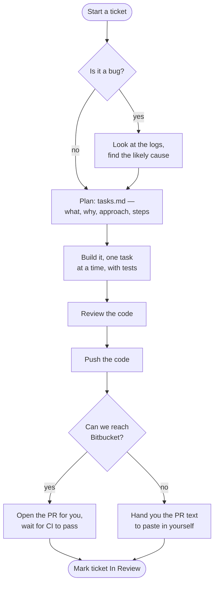
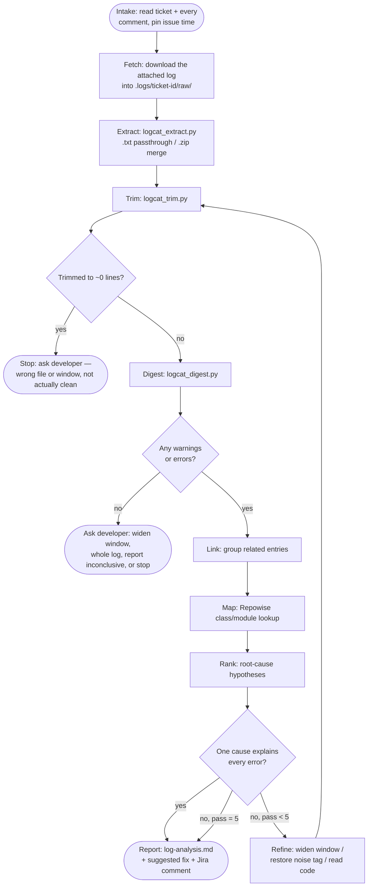

# Agentic AI-SDLC workflow — implementation reference

Design reference for what actually runs inside this repo: the daily ticket pipeline, the
log-analysis loop, the safety mechanisms wrapping all of it, and — in §10 — exactly where every one
of those files lives. Each skill's own `SKILL.md` is the authoritative source for its own
behavior — this document is a synthesis for a single-page view, not a replacement.

This workflow's files are edited directly, in place — there's no wizard, no templating, no
detection logic. The one remaining moving part is `install.sh` (see
[README.md §2](../README.md#2-one-time-setup)): a plain file sync, run from inside the actual app
repo, that pulls the latest agents/skills/instructions/prompts/mcp config from this repo and
overwrites them there — a one-way copy, not a generator run against detected app-repo state.

## 1. One-time manual fill-ins

Three things can't be read off the code or guessed, so `install.sh` never overwrites
them once they exist — they're filled in once by hand instead:

- `copilot-instructions.md`'s settings block (`jira_projects`, `base_branch`), module map, and key
  rules.
- `project-context.md` and `architecture.md`, drafted from the real code per
  [`docs/field-sources.md`](https://github.com/saraths-99/github-workflow/blob/develop/docs/field-sources.md), confirmed by a developer, then never regenerated —
  edited directly as facts change.
- MCP tokens, added to your own local config, never committed.

## 2. Daily ticket workflow (spec-driven development)

The shape of it, start to finish. The developer approves every step along the way — nothing moves
to the next box without an explicit yes — and a failed check always loops back to the box before
it, rather than skipping forward.



The Plan box is one agent, one file, one approval: `qatalyst-bug-planner` for a bug ticket (after
the
log-analysis loop), `qatalyst-feature-planner` otherwise. Earlier versions of this workflow split
Plan into
three separate files and three separate approvals (requirements, then design, then tasks) written
by two different agents — that meant asking the developer to approve three times, and a duplicate
ask for the feature folder name along the way (one agent resolved it, the next one re-confirmed
it). `tasks.md` now carries what the old `requirements.md` and `design.md` covered — what the ticket
is for, acceptance criteria, edge cases, approach/risks — as sections ahead of the task checklist, in
the single file `qatalyst-code-reviewer` and `qatalyst-test-writer` check against. For a bug, the first
acceptance criterion is the reported scenario itself, so the fix is planned with a test that
reproduces it; each edge case is tied to the task whose test covers it.

That "Can we reach Bitbucket" step is a real, current gap worth naming plainly: opening a PR and checking CI both need
Bitbucket access through the Atlassian Rovo MCP server, which depends on a scoped API token and an
admin turning on the Bitbucket tools — nothing this workflow controls. Without it, this workflow
never blocks on it; it just hands the developer the PR text to paste in by hand instead (see
`qatalyst-ticket-ship`'s own `SKILL.md`, "If the Bitbucket tools aren't available").

### Workflow report

When every task is ticked, `qatalyst-developer` follows `qatalyst-repowise-lookup`'s "Workflow
report" steps and writes `.logs/<ticket ID>/workflow-report.md`. For a bug it starts with how many of
the 5 allowed analysis passes it took to reach a confident fix (copied from `log-analysis.md`'s
"Analysis passes" section, one line per pass and how it ended). It then covers the blast radius: the
files and symbols the ticket changed, their dependents in every repo of the workspace, the change risk, the tests around the
change, and whether each changed file is current in Repowise's index. It tells the developer in chat
whether the index was used (every lookup, some, or none and why) and names any stale files. Without
Repowise it still writes the report from direct searches and marks every row as such. The ship
step shows the summary in its confirmation. A "Workflow checks" section records, self-reported by the
agent, how the token report went (written, off, no hand-off received, or failed with the reason),
which hand-off it received, and the Repowise index and commit hook status; anything it wasn't told is
"not recorded". The token report step therefore runs before the workflow report. The report covers only its own lookups and the
ticket-start status, not lookups made earlier by the planners or the log analyser.

### Token usage per ticket (Beta — works in VS Code)

This feature is in beta and runs in VS Code only. `qatalyst-ticket-start` checks which IDE it is in
(VS Code has the `vscode/askQuestions` tool), runs `mark` only there, and tells the agents it hands
off to "Token tracking: on" or "off"; `qatalyst-developer` writes the report only when told "on".
Elsewhere nothing is created.

`.github/token-tracker/scripts/token_tracker.py` reports how many tokens a ticket used, one row per
model call: `ticketId`, `agentName`, `model`, `inputTokens`, `outputTokens`, `timestamp`, plus a
summary by agent and by model. It reads only what Copilot itself records locally; nothing is sent
anywhere, and prompt or code content is never captured.

| Where the developer works | Trace source | What's available |
|---|---|---|
| VS Code Copilot Chat | `agent-traces.db` in VS Code's storage for the Copilot Chat extension, turned on by `github.copilot.chat.otel.dbSpanExporter.enabled` | every model call, by agent and sub-agent |

- **Turning it on in VS Code.** The setting isn't listed in the Settings screen, so searching for it
  there finds nothing; it goes in a settings JSON file. VS Code reads it from only two places: the
  app repo's own `.vscode/settings.json` (the folder open in VS Code, not this workflow repo), or
  the user settings (**Preferences: Open User Settings (JSON)**). `.github/token-tracker/vscode-settings.json`
  is only the template `install.sh` copies into a new `.vscode/settings.json`; editing it changes
  nothing. Add `"github.copilot.chat.otel.dbSpanExporter.enabled": true`, run **Developer: Reload
  Window**, send one chat message, and check that `agent-traces.db` now exists
  (`~/.config/Code/User/globalStorage/github.copilot-chat/` on Linux,
  `~/Library/Application Support/Code/User/globalStorage/github.copilot-chat/` on macOS). If the
  setting shows "Unknown configuration setting", the installed Copilot Chat extension is too old to
  have it.

- **Linking chats to a ticket.** Copilot's traces don't contain a ticket ID. A chat is linked when
  `token_tracker.py mark <ticket ID>` runs during it (`qatalyst-ticket-start` does this first, in
  VS Code only), or, failing that, when any turn in it ran on a branch named
  for the ticket. The `qatalyst-ticket` picker agent has no terminal tool, so its chats rely on the
  branch rule.
- **Agent names.** An agent picked from the picker is recorded by Copilot as "GitHub Copilot Chat"
  with its own name in a separate attribute; the tracker uses that name. A chat with no custom agent
  shows as "GitHub Copilot Chat".
- **Skills** make no model calls of their own, so they have no rows: a skill's text is
  counted in the input tokens of the agent that loaded it.
- **Retention.** Copilot deletes its own trace rows after 7 days, so every `collect`/`report` run
  copies new calls into `.logs/token-tracker/calls.jsonl` (git-ignored), and reports are built from
  that copy. Calls recorded against a different repo's remote URL are skipped.
- **Why not Copilot's `file` exporter in VS Code.** As of Copilot Chat's current source, its file
  exporter serializes span objects directly, which fails on a circular reference and writes `{}`
  for every span (reproduced with OpenTelemetry SDK 2.5.1 and 2.12.1). The SQLite store converts
  spans to plain rows first and doesn't have this problem.

`qatalyst-developer` runs `token_tracker.py report <ticket ID> --open` once every task in
`tasks.md` is ticked, before pointing the developer at `/qatalyst-ticket-ship`; a developer can run
it again any time, for example after shipping to include the review and ship steps. Output goes to `.logs/token-tracker/<ticket ID>/`:
`token-usage.html` (a self-contained page with no scripts, opened in the browser by `--open` where
there's a local display) and `token-usage.json` (one row per call under `calls`, plus `totals` and a
per-agent `byAgent` breakdown). Both come from the same data.

## 3. Log-analysis loop (bug tickets only)



If the ticket has a log but gives no time for the issue, Intake asks the developer for one instead of
guessing: a time of day, the whole log with no time window, or stop until the ticket has it.

A log attached to the ticket (rather than pasted in a comment) is downloaded by `qatalyst-log-analyser`
through the Atlassian server's `downloadJiraIssueAttachment` operation, into `.logs/<ticket ID>/raw/`.
If the download can't run, the developer is told which step failed and
which file name to save the log as.

Three scripts in this loop are plain Python, no AI, no network: `logcat_extract.py` normalizes the
raw attachment (a plain `.txt`/`.log` passes through unchanged; a `.zip` is extracted and, if it
holds more than one text log, merged in chronological order) into the single file `logcat_trim.py`
expects, and `logcat_digest.py` groups that trimmed log's warnings and errors by signature.

## 4. Agents

Every workspace agent uses the VS Code Copilot custom-agent schema: `.agent.md` under
`.github/agents/`, `target: github-copilot`, supported tool aliases (`execute`, not
`runCommands`), and configured MCP namespaces in `tools` (for example `repowise/*`). These agents
are workflow workers, so `user-invocable: false` hides them from the picker while keeping
model-driven delegation enabled. Agents that delegate include the `agent` tool; agents that use a
repo skill list it in `skills`. The portable server definitions live in the workspace-root
`.mcp.json`.

Each agent's `tools` also lists the names Android Studio's Copilot registers its tools under, after
the VS Code groups they correspond to: `read` → `read_file`, `list_dir`, `get_errors`; `search` →
`grep_search`, `file_search`, `semantic_search`; `edit` → `insert_edit_into_file`, `create_file`;
`execute` → `run_in_terminal`, `get_terminal_output`. Each IDE ignores the names it doesn't know.
Without them, a sub-agent started in Android Studio can come up with no tools, and the agent that
started it does the work itself instead ("the subagent sandbox doesn't have access to this
workspace's tools"). Android Studio's name for the `agent` (sub-agent) tool isn't known yet, so
delegation there still depends on `agent` being recognised; `x-github-copilot-invoke-policy` mirrors
`user-invocable` for its picker.

**Model tiers.** An agent's `model:` frontmatter pins its model, as a list of
`<name> (copilot)` entries tried in order; an agent without one runs on the model of whatever started
it.

| Tier | Claude, in order | GPT, in order | Agents |
|---|---|---|---|
| Deep | Opus 5.5 → Sonnet 5.5 | GPT-5.6 Sol → GPT-6.1 Sol | Set by `qatalyst-ticket` and the `/qatalyst-ticket-start`, `/log-analyser` and `/qatalyst-ticket-ship` prompts; pinned on `qatalyst-log-analyser`. Unpinned, so they run on the chat's model: `qatalyst-bug-planner`, `qatalyst-feature-planner` |
| Standard | Sonnet 5.5 → Sonnet 5 | GPT-6.1 Sol | `qatalyst-developer`, `qatalyst-code-reviewer`, `qatalyst-error-handling-reviewer`, `qatalyst-test-writer`, `qatalyst-ble-protocol-test-writer`, `qatalyst-security-test-writer`, `qatalyst-security-reviewer`; also the `/qatalyst-write-tests`, `/qatalyst-new-*` and `/qatalyst-room-migration` prompts |
| Fast | Haiku 5.5 → Haiku 4.5 | GPT-6 Luna → GPT-5.6 Luna | `qatalyst-log-ticket-intake` and the unit, androidTest, compatibility, interop, OTA, performance and chaos test writers |

**One provider throughout.** The developer chooses Claude or GPT when installing (`install.sh
--provider claude|gpt`, or the question it asks on a first install; the choice is kept in
`.github/workflow-sync.md` and reused on later runs). The lists live in `models.json`, and
`set-models.py` copies the chosen provider's list for each tier into every agent's and prompt's
`model:` line in the app repo. The files in this repo carry the Claude lists; `models.json` and
`set-models.py` stay here and aren't installed. Because every agent then runs on one provider's
models, the plan must include that provider's models; there is no fallback to the other vendor. The
choice is per app repo and changes by re-running the install with the other `--provider`. Where an
IDE ignores `model:` (Android Studio isn't confirmed to read it), every agent runs on whichever
model is picked in the chat, so pick one from the same provider.

Each tier stays inside one of Copilot's own categories (Powerful, Versatile, Lightweight) at a
similar token price across the two providers: GPT-6.1 Sol is rated Powerful at $2 in / $10 out per
million tokens, the same price as Sonnet 5.5; GPT-5.6 Sol matches Opus 5.5 at $4 / $20; GPT-6 Luna
($0.10 / $0.50) matches Haiku 5.5. GPT-6 Astra ($10 / $50) is left out: it costs 2.5× Opus 5.5, and a
sub-agent can't run on a costlier model than its chat. Gemini, Grok and MAI-Code aren't listed;
adding a provider means adding a block to `models.json` with the same three tiers.

VS Code refuses to start a sub-agent on a model that costs more than the model of the chat (or
agent) that started it, so cost only ever steps down along a chain: chat → `qatalyst-developer` →
`qatalyst-test-writer` → a test writer. That is why the two planners are left unpinned and the entry
points carry the top pin, and why every prompt that starts a pinned agent pins at least that tier
itself. VS Code checks that rule against the first name it finds, so an entry that costs more than
the chat fails instead of moving on to the next. If none of an agent's names is in a developer's
model picker, the agent falls back to its starter's model. Whether Android Studio's Copilot reads
`model:` isn't known; if it doesn't, every agent there runs on the model picked in the chat.

**Naming migration (complete).** Every agent file and every skill folder in this workflow carries
the `qatalyst-` prefix — the last holdouts (the nine specialized test-writer sub-agents, plus the
13 skills and `log-ticket-intake` that were still unprefixed) were renamed in one pass, along with
every cross-reference and the 8 skill-backed slash commands that renamed to match (e.g.
`/ticket-start` → `/qatalyst-ticket-start`). `/log-analyser` is the one slash command left
unprefixed, since it's backed directly by the already-prefixed `qatalyst-log-analyser` agent, not
by a skill of its own.

| Agent | Job | Copilot tools | Hard scope rule |
|---|---|---|---|
| `qatalyst-log-ticket-intake` | Reads the bug ticket's full text and pins the issue time and log attachment type; `qatalyst-log-analyser`'s own Intake step | read, search, atlassian-rovo/* | Read-only — writes nothing, never touches a log script |
| `qatalyst-log-analyser` | Root-causes a bug ticket's logs with a suggested fix; the loop is its own procedure | read, edit, search, execute, agent, atlassian-rovo/*, repowise/* | Writes only `log-analysis.md`; runs only the three log scripts, in order |
| `qatalyst-bug-planner` | Writes `tasks.md` for a bug ticket, from `log-analysis.md`; mechanics live in the `qatalyst-plan-ticket` skill | read, edit, search, atlassian-rovo/*, repowise/* | Writes only `tasks.md`, to the same deterministic `specs/bug/<ticket ID>/` path `qatalyst-log-analyser` already used |
| `qatalyst-feature-planner` | Writes `tasks.md` for a feature ticket; mechanics live in the `qatalyst-plan-ticket` skill | read, edit, search, atlassian-rovo/*, repowise/* | Writes only `tasks.md`, to the deterministic `specs/feature/<ticket ID>/` path — nothing to resolve or ask about |
| `qatalyst-developer` | Implements `tasks.md` | read, edit, search, execute, agent, repowise/* | One task at a time, in order, only via the named skill |
| `qatalyst-test-writer` | Routes a task to the matching test-writer sub-agent(s) | read, search, agent, repowise/* | Pure router — no `edit`/`execute` itself; writes nothing |
| `qatalyst-unit-test-writer` | ViewModel/service/repository/mapper/Room tests | read, edit, search, execute, repowise/* | Edits only test files for the in-progress task |
| `qatalyst-ble-protocol-test-writer` | Fake-device BLE command tests | read, edit, search, execute, repowise/* | Edits only test files; never a real lock/GDO unit |
| `qatalyst-androidtest-writer` | Instrumented UI tests | read, edit, search, execute, repowise/* | Edits only `**/androidTest/**` |
| `qatalyst-compatibility-test-writer` | Lock-model capability-matrix tests | read, edit, search, execute, repowise/* | Edits only test files for the in-progress task |
| `qatalyst-security-test-writer` | Tests for security-sensitive logic | read, edit, search, execute, repowise/* | Edits only test files; only runs when flagged by `qatalyst-code-reviewer` |
| `qatalyst-interop-test-writer` | Hardware-in-the-loop interop test plan | read, edit, search, repowise/* | Plan only — writes `test-plans/interop.md`, never code |
| `qatalyst-ota-test-writer` | Firmware OTA test plan | read, edit, search, repowise/* | Plan only — writes `test-plans/ota.md`, never code |
| `qatalyst-performance-test-writer` | Performance/battery test plan | read, edit, search, repowise/* | Plan only — writes `test-plans/performance.md`, never code |
| `qatalyst-chaos-test-writer` | Resilience/fault-injection test plan | read, edit, search, repowise/* | Plan only — writes `test-plans/chaos.md`, never code |
| `qatalyst-code-reviewer` | Reviews diff vs. spec; checklist is its own procedure | read, search, agent, repowise/* | Read-only; checks the specs-only rule on every diff |
| `qatalyst-security-reviewer` | Reviews sensitive-area diffs; checklist is its own procedure | read, search, repowise/* | Read-only; only runs when flagged by `qatalyst-code-reviewer` |
| `qatalyst-error-handling-reviewer` | Reviews failure-handling in services/repos/BLE/API diffs; checklist is its own procedure | read, search, repowise/* | Read-only; only runs when flagged by `qatalyst-code-reviewer` |

Tool lists are the *mechanical* half of scope enforcement (Copilot can strip `edit` outright); the
*written* half — "only these files," "only these commands" — lives in each agent's own blueprint.
`qatalyst-code-reviewer` is the backstop that actually checks the written half was followed.

- **Why reviewers get no edit tool.** Removing `edit` from the tool list is the one scope rule
  Copilot *can* enforce mechanically — so `qatalyst-code-reviewer`, `qatalyst-security-reviewer`,
  and `qatalyst-error-handling-reviewer` all have it removed outright, instead of relying on a
  written instruction alone.
- **Why `qatalyst-test-writer` itself has no `edit` tool.** It's a pure router now — the nine
  specialized writers it hands off to do the actual writing, so `qatalyst-test-writer` needs
  nothing more than `read` and `search` to decide where a task's tests belong.
- **Why four of the nine test-writer sub-agents have no `execute` tool.** `qatalyst-interop-test-writer`,
  `qatalyst-ota-test-writer`, `qatalyst-performance-test-writer`, and `qatalyst-chaos-test-writer` can't execute anything — no
  fake stands in honestly for a real lock, a firmware rig, or a battery-drain bench — so they write a
  markdown test plan under `edit` and nothing more; there's nothing for `execute` to run.
- **Why `qatalyst-log-analyser`'s command scope is written, not mechanical.** Copilot has no
  per-command allowlist in a tool list — "can run commands" is all-or-nothing. So
  `qatalyst-log-analyser`'s blueprint states explicitly that it may only invoke the three named
  scripts; `qatalyst-code-reviewer` isn't the backstop here (its phase is before any code diff
  exists) — the backstop is the developer reviewing `log-analysis.md` and the redacted Jira comment
  it posts.
- **Every `repowise` grant needs its own usage + fallback line.** Granting `repowise/*` in an agent's
  `tools` list isn't self-explanatory — Copilot's tool list has no way to express "try this, then
  fall back," so that behavior is written into the agent's own body: what it uses Repowise for, and
  what to do when it's unavailable (always: fall back to a direct file read/search for that lookup,
  never block or retry). Within one run, check Repowise once and remember the result — don't keep
  retrying it on every subsequent lookup in the same task.

## 5. Skills

| Layer | Skills |
|---|---|
| **Orchestration** | `qatalyst-ticket-start`, `qatalyst-ticket-ship`, `qatalyst-write-tests` (routes to `qatalyst-test-writer` for a standalone test-only task, same as a ticket task) |
| **Implementation** | `qatalyst-new-feature`, `qatalyst-new-screen`, `qatalyst-new-ble-command`, `qatalyst-new-api-call`, `qatalyst-room-migration` |
| **Agent-support** (not a slash command — delegated to by the agents it backs) | `qatalyst-plan-ticket` (`qatalyst-bug-planner`, `qatalyst-feature-planner`) — the only agent-support skill left; `review-diff`, `review-security`, `review-error-handling`, and `analyse-logs` were folded directly into their one respective caller's own agent body (`qatalyst-code-reviewer`, `qatalyst-security-reviewer`, `qatalyst-error-handling-reviewer`, `qatalyst-log-analyser`) since each had exactly one caller and no sharing to preserve |
| **Cross-cutting** (shared mechanics, referenced by multiple agents/skills above rather than restated) | `qatalyst-jira-ticket-intake` (reading a Jira ticket in full, with an issue-time-pinning extension), `qatalyst-spec-folder-resolution` (computing the deterministic `specs/<bug\|feature>/<ticket ID>/` path — no listing, no asking), `qatalyst-repowise-lookup` (the Repowise-then-fallback, check-once pattern), `qatalyst-ask-developer` (every stop is a question with options — `vscode/askQuestions` in VS Code, `ask_questions` in Android Studio, `ask_user` in the Copilot CLI, numbered options where none exists — never an open-ended prompt), `qatalyst-koin-wiring` (registering a binding in `AppModule.kt`) |

`qatalyst-ticket` is a `user-invocable: true` agent-picker entry point that wraps `qatalyst-ticket-start` with
no procedure of its own — an alternative surface to typing `/qatalyst-ticket-start <ticket ID>`, not a
replacement for it; the two must be kept in sync if `qatalyst-ticket-start`'s flow changes.

## 6. Hooks

This workflow ships no hooks. An earlier version had four guard hooks (a Kotlin formatter, a
force-push block, a secret and sensitive-path guard, and a context-doc guard). They were removed
in 0.4.8, and `install.sh` deletes the copies an older install left in an app repo.

Without them, the guards are the mechanical tool lists (reviewers have no `edit` tool) and the
written rules in each agent and instruction file, checked by `qatalyst-code-reviewer`. Commands and
edits are covered only by Copilot's own approval prompts, so read them before you allow them.

## 7. MCP servers

| Server | Used for | Auth |
|---|---|---|
| Atlassian Rovo MCP | Jira, Confluence, Bitbucket Cloud | OAuth (Jira/Confluence); Basic auth API token (Bitbucket) |
| Repowise | Code map, risk, dead-code (advisory only) | None — local, optional |

`/qatalyst-ticket-start` checks Repowise at the start of every ticket. If it isn't ready (not
installed, not indexed, or repos missing or behind), it asks the developer to set it up, continue
without it, or stop, and tells every agent it hands off to the outcome so none re-checks. It never
runs the install or index commands itself. Once Repowise is ready it also checks `repowise hook
status --workspace` and installs the post-commit hook (`repowise hook install <repo>`, never
`--security`) in each repo that lacks it and has no post-commit hook of its own, so the index is
re-built after every commit. This is a local git hook, not one of the Copilot guard hooks removed
from this workflow.

Atlassian is reached at `https://mcp.atlassian.com/v2/mcp` (the `/v1/sse` endpoint was retired on
30 June 2026). Setup and sign-in per IDE, including Android Studio's Local agent, are in the
`.github/workflow-guide.md`, "MCP servers".

## 8. Safety & control principles

- **Developer approves every gate** — each spec file, every task, and the commit/push/PR step all
  wait for an explicit yes.
- **Spec before code** — no ticket branch exists until `tasks.md` is approved; `qatalyst-developer`
  can't start a task the spec doesn't list.
- **Context docs are read, not guessed** — `project-context.md`/`architecture.md` are drafted once
  from the real code, cited line-by-line, never regenerated once written.
- **Redact before sharing** — raw logs stay in a git-ignored `.logs/` folder; everything else sees
  only trimmed/digested/redacted output.
- **Mechanical enforcement where possible, written rules elsewhere** — reviewers lose the `edit`
  tool outright; path-scoping ("specs only," "scripts only") is a written rule, checked by
  `qatalyst-code-reviewer`.
- **No secrets in the repo** — both MCP files ship with an empty token slot.
- **A model per job** — the ticket chat, log analysis and planning run on the strongest model, since
  a weaker one is more likely to skip an approval gate or misclassify a ticket than to be caught
  doing so; implementation and review run a tier below, and most test writing on a fast model (see
  §4's model tiers and `copilot-instructions.md`'s Model section).

## 9. Known gaps / open risk items

Found by audit, not yet closed — listed here so they stay visible rather than living only in chat:

1. **Test/spec gaming under pressure** — nothing stops `qatalyst-test-writer` from weakening an
   assertion,
   or the "plan changed" re-approval path (`qatalyst-bug-planner`/`qatalyst-feature-planner`) from
   being used to dodge
   a hard bug rather than fix it.
2. **UI error/loading/empty states** — `qatalyst-new-screen` and `xml-ui.instructions.md` stop at wiring;
   nothing requires a screen to handle or test a failure/loading/empty state.
3. **No retry cap for `qatalyst-developer`/`qatalyst-test-writer`** — unlike
   `qatalyst-log-analyser`'s 5-pass cap, nothing
   says "stop and report" after N failed attempts at a task.
4. **"Resolved" is undefined** for review comments — unclear if a developer override counts.
5. **Ticket reclassified after `qatalyst-ticket-start` runs** — issue type is read once; a later
   feature→bug (or reverse) reclassification isn't re-checked.
6. **Technically-passing-but-wrong-approach implementations** — `qatalyst-code-reviewer` checks
   criteria are
   met, not that the approach matches `tasks.md`'s Approach section's intent.
7. **Flaky test passes** — the gate is "passed locally, once"; no rule addresses intermittent tests.
8. **Branch/feature-folder collisions** — no rule for two tickets proposing the same slug.
9. **Plan-only test categories have no execution gate** — `qatalyst-interop-test-writer`, `qatalyst-ota-test-writer`,
    `qatalyst-performance-test-writer`, and `qatalyst-chaos-test-writer` only guarantee a plan file exists and is
    current; nothing in this workflow checks that a human actually ran it against real hardware
    before the ticket ships, or records the result anywhere `qatalyst-ticket-ship` can see.
10. **No guard on commands or secrets** — with the hooks gone, nothing mechanical stops an agent
    from running `git push --force`, reading a keystore or the raw logs, or posting a token in a
    Jira or PR comment; only the written rules and Copilot's own approval prompts stand in the way.

## 10. Folder structure

Where every file lives in this repo, and which of those paths are a real GitHub Copilot standard
versus a convention this workflow invented for itself.

### 10.1 Repo layout

```
<app-repo>/
├── .mcp.json                         portable workspace MCP servers for Copilot
├── project-context.md                 filled in by hand once; never regenerated
├── architecture.md                    same
├── workflow.prompt.md                 pre-existing team doc, if any — linked, not written here
├── docs/workflows/                    pre-existing team docs, if any
├── docs/workflow-design.md            this document
├── .gitignore                         .logs/, .github/, .repowise/, .vscode/, docs/workflow-design.md, specs/.templates/ ignored
├── specs/
│   └── .templates/
│       └── tasks-template.md          scaffold only — see §10.3 for the -template.md convention
├── .logs/                             created lazily, git-ignored — see §10.2
└── .github/
    ├── workflow-sync.md               written every install.sh run — version, commit, timestamp; never hand-edited
    ├── copilot-instructions.md        settings block + module map + key rules + links
    ├── instructions/
    │   ├── kotlin.instructions.md
    │   ├── xml-ui.instructions.md
    │   ├── koin-di.instructions.md
    │   ├── ble-halo.instructions.md
    │   ├── ble-gdo.instructions.md
    │   ├── data-layer.instructions.md
    │   ├── testing.instructions.md
    │   └── gradle.instructions.md
    ├── agents/
    │   ├── qatalyst-ticket.agent.md            user-invocable entry point, wraps qatalyst-ticket-start
    │   ├── qatalyst-log-ticket-intake.agent.md         qatalyst-log-analyser's own Intake step
    │   ├── qatalyst-log-analyser.agent.md
    │   ├── qatalyst-bug-planner.agent.md
    │   ├── qatalyst-feature-planner.agent.md
    │   ├── qatalyst-developer.agent.md
    │   ├── qatalyst-test-writer.agent.md     router only — see below
    │   ├── qatalyst-unit-test-writer.agent.md
    │   ├── qatalyst-ble-protocol-test-writer.agent.md
    │   ├── qatalyst-androidtest-writer.agent.md
    │   ├── qatalyst-compatibility-test-writer.agent.md
    │   ├── qatalyst-security-test-writer.agent.md
    │   ├── qatalyst-interop-test-writer.agent.md     plan only
    │   ├── qatalyst-ota-test-writer.agent.md         plan only
    │   ├── qatalyst-performance-test-writer.agent.md plan only
    │   ├── qatalyst-chaos-test-writer.agent.md       plan only
    │   ├── qatalyst-code-reviewer.agent.md
    │   ├── qatalyst-security-reviewer.agent.md
    │   └── qatalyst-error-handling-reviewer.agent.md
    ├── log-analyser/
    │   ├── scripts/logcat_extract.py
    │   ├── scripts/logcat_trim.py
    │   └── scripts/logcat_digest.py
    ├── skills/
    │   ├── qatalyst-new-feature/SKILL.md
    │   ├── qatalyst-new-screen/SKILL.md
    │   ├── qatalyst-new-ble-command/SKILL.md
    │   ├── qatalyst-new-api-call/SKILL.md
    │   ├── qatalyst-room-migration/SKILL.md
    │   ├── qatalyst-koin-wiring/SKILL.md              cross-cutting
    │   ├── qatalyst-plan-ticket/SKILL.md              agent-support, not a slash command
    │   ├── qatalyst-jira-ticket-intake/SKILL.md       cross-cutting
    │   ├── qatalyst-spec-folder-resolution/SKILL.md   cross-cutting
    │   ├── qatalyst-repowise-lookup/SKILL.md          cross-cutting
    │   ├── qatalyst-ask-developer/SKILL.md            cross-cutting
    │   ├── qatalyst-write-tests/SKILL.md
    │   ├── qatalyst-ticket-start/SKILL.md
    │   └── qatalyst-ticket-ship/
    │       ├── SKILL.md
    │       └── pipelines-detection.md
    ├── prompts/
    │   ├── log-analyser.prompt.md
    │   ├── qatalyst-new-feature.prompt.md
    │   ├── qatalyst-new-screen.prompt.md
    │   ├── qatalyst-new-ble-command.prompt.md
    │   ├── qatalyst-new-api-call.prompt.md
    │   ├── qatalyst-room-migration.prompt.md
    │   ├── qatalyst-write-tests.prompt.md
    │   ├── qatalyst-ticket-start.prompt.md
    │   └── qatalyst-ticket-ship.prompt.md
    └── token-tracker/
        ├── scripts/token_tracker.py   mark / collect / report — per-ticket token usage
        └── vscode-settings.json       the one VS Code setting tracing needs; copied to .vscode/settings.json if the app repo has none
```

### 10.2 Per-ticket runtime additions

Not present until a ticket is actually worked; one set per ticket, at a path computed
deterministically from the ticket's type and ID — never a feature-name folder, never asked about.

```
specs/<bug|feature>/<ticket-id>/
├── log-analysis.md      bug tickets only — written by qatalyst-log-analyser
├── tasks.md              written by qatalyst-bug-planner (bug) or qatalyst-feature-planner (feature)
└── test-plans/           only if a plan-only test-writer sub-agent ran for this ticket
    ├── interop.md         written by qatalyst-interop-test-writer
    ├── ota.md             written by qatalyst-ota-test-writer
    ├── performance.md     written by qatalyst-performance-test-writer
    └── chaos.md           written by qatalyst-chaos-test-writer

.logs/<ticket-id>/
├── raw/                 as captured (.txt/.log, or a .zip) — qatalyst-log-analyser's rules say never read it; the attachment download (a single https `curl -o`) writes here
│   └── extracted/        logcat_extract.py's output — still the full raw log, so the same rule applies
├── trimmed.log           redacted + windowed — what qatalyst-log-analyser actually reads
├── digest.md             error groups with counts and first/last times
├── workflow-report.md    written when every task is ticked: analysis passes (bugs), what changed, who depends on it, risk, and whether Repowise's index was used
└── in-progress.json      only while a task or the ship step runs; still there on resume = the last chat broke midway

.logs/token-tracker/
├── markers.jsonl         one line per `token_tracker.py mark` — ticket ID + time
├── calls.jsonl           every model call copied from Copilot's traces (they expire after 7 days)
└── <ticket-id>/
    ├── token-usage.html  the report as a page; opened by report --open
    └── token-usage.json  ticketId, agentName, model, inputTokens, outputTokens, timestamp per call,
                          plus totals and byAgent
```

### 10.3 Naming conventions: specification compliance

Every path under `.github/` conforms to a documented GitHub Copilot customization path, verified
against the [customization cheat sheet](https://docs.github.com/en/copilot/reference/customization-cheat-sheet),
with two exceptions: `.github/workflow-sync.md` and `.github/token-tracker/`, project-specific
conventions this workflow keeps there purely because `.github/` is where the rest of its files
already live. Every path outside
`.github/` — `specs/`, the `-template.md` suffix — is also a project-specific convention introduced
by this workflow; GitHub Copilot has no knowledge of any of these and assigns them no behavior.

| Path / suffix | Classification | Notes |
|---|---|---|
| `.github/copilot-instructions.md` | GitHub Copilot specification | Repository-wide instructions |
| `.github/instructions/*.instructions.md` | GitHub Copilot specification | Path-specific instructions; requires an `applyTo` front-matter field |
| `.github/prompts/*.prompt.md` | GitHub Copilot specification | Slash-command shortcuts |
| `.github/agents/*.md` | Location per specification; `.agent.md` suffix is a project convention | The specification requires only that the file reside in `.github/agents/`; the `.agent.md` suffix is applied by this workflow for readability and is not required by GitHub Copilot |
| `.github/skills/<name>/SKILL.md` | GitHub Copilot specification | Also valid under `.claude/skills/` or `.agents/skills/`; this workflow does not write to either location |
| `.github/workflow-sync.md` | Project-specific convention | Not a GitHub Copilot concept; written fresh by every `install.sh` run, never hand-edited |
| `.github/token-tracker/` | Project-specific convention | Not a GitHub Copilot concept; scripts that read Copilot's local traces. Only the setting it relies on, `github.copilot.chat.otel.dbSpanExporter.enabled`, is Copilot's own |
| `specs/<bug\|feature>/<ticket-id>/` | Project-specific convention | Not a GitHub Copilot concept; the path is computed deterministically (never asked about) and honored by `qatalyst-bug-planner`, `qatalyst-feature-planner`, and `qatalyst-log-analyser` |
| `specs/.templates/*-template.md` | Project-specific convention | The `-template` suffix excludes the scaffold from any glob that scans `specs/**/tasks.md` for live ticket specs, while the `.md` extension preserves Markdown rendering in editors and previews |
| `jira_projects` settings-block field (and its per-entry `key`/`bug_issue_types`) | Project-specific convention | Not a GitHub Copilot concept; read by `qatalyst-ticket-start` at the start of every ticket |

**Implication.** A path classified as GitHub Copilot specification is governed by GitHub's
published behavior and remains valid for as long as that specification does. A path classified as a
project-specific convention carries no external enforcement — it functions only because every
agent and skill that reads or writes it has been written to honor it consistently. Any change to
the `specs/` layout or the `-template.md` convention must therefore be mirrored across all of them.
