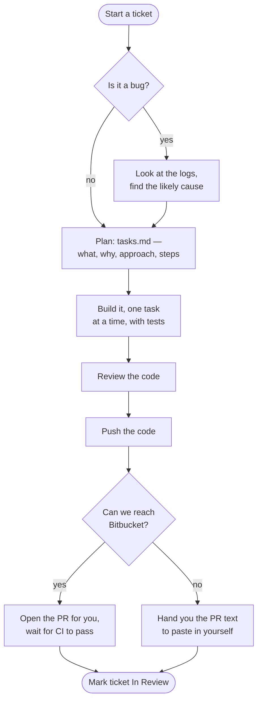
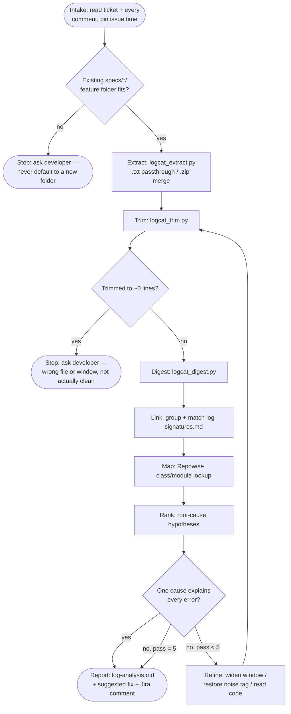

# Agentic AI-SDLC workflow — implementation reference

Design reference for what actually runs inside this repo: the daily ticket pipeline, the
log-analysis loop, the safety mechanisms wrapping all of it, and — in §11 — exactly where every one
of those files lives. Each skill's own `SKILL.md` is the authoritative source for its own
behavior — this document is a synthesis for a single-page view, not a replacement.

This workflow's files are edited directly, in place — there's no wizard, no templating, no
detection logic. The one remaining moving part is `install.sh`/`install.ps1` (see
[README.md §2](../README.md#2-one-time-setup)): a plain file sync, run from inside the actual app
repo, that pulls the latest agents/skills/instructions/hooks/prompts/mcp config from this repo and
overwrites them there — a one-way copy, not a generator run against detected app-repo state.

## 1. One-time manual fill-ins

Three things can't be read off the code or guessed, so `install.sh`/`install.ps1` never overwrite
them once they exist — they're filled in once by hand instead:

- `copilot-instructions.md`'s settings block (`jira_projects`, `base_branch`), module map, and key
  rules.
- `project-context.md` and `architecture.md`, drafted from the real code per
  [`docs/field-sources.md`](field-sources.md), confirmed by a developer, then never regenerated —
  edited directly as facts change.
- MCP tokens, added to your own local config, never committed.

## 2. Daily ticket workflow (spec-driven development)

The shape of it, start to finish. The developer approves every step along the way — nothing moves
to the next box without an explicit yes — and a failed check always loops back to the box before
it, rather than skipping forward.



The Plan box is one agent, one file, one approval: `qatalyst-bug-planner` for a bug ticket (after
the
log-analysis loop), `qatalyst-feature-planner` otherwise. Earlier versions of this workflow split
Plan into
three separate files and three separate approvals (requirements, then design, then tasks) written
by two different agents — that meant asking the developer to approve three times, and a duplicate
ask for the feature folder name along the way (one agent resolved it, the next one re-confirmed
it). `tasks.md` now carries what the old `requirements.md` and `design.md` covered — what the ticket
is for, acceptance criteria, approach/risks — as sections ahead of the task checklist, in the single
file `qatalyst-code-reviewer` and `qatalyst-test-writer` check against.

That "Can we reach Bitbucket" step is a real, current gap worth naming plainly: opening a PR and checking CI both need
Bitbucket access through the Atlassian Rovo MCP server, which depends on a scoped API token and an
admin turning on the Bitbucket tools — nothing this workflow controls. Without it, this workflow
never blocks on it; it just hands the developer the PR text to paste in by hand instead (see
`ticket-ship`'s own `SKILL.md`, "If the Bitbucket tools aren't available").

## 3. Log-analysis loop (bug tickets only)



Three scripts in this loop are plain Python, no AI, no network: `logcat_extract.py` normalizes the
raw attachment (a plain `.txt`/`.log` passes through unchanged; a `.zip` is extracted and, if it
holds more than one text log, merged in chronological order) into the single file `logcat_trim.py`
expects, and `logcat_digest.py` groups that trimmed log's warnings and errors by signature.
`log-signatures.md`'s "Tag → module map" is filled in once by hand from a scan of this repo's
`Log.d/Log.w/Log.e` call sites, then kept up to date as new tags are added.

## 4. Agents

Every workspace agent uses the VS Code Copilot custom-agent schema: `.agent.md` under
`.github/agents/`, `target: github-copilot`, supported tool aliases (`execute`, not
`runCommands`), and configured MCP namespaces in `tools` (for example `repowise/*`). These agents
are workflow workers, so `user-invocable: false` hides them from the picker while keeping
model-driven delegation enabled. Agents that delegate include the `agent` tool; agents that use a
repo skill list it in `skills`. The portable server definitions live in the workspace-root
`.mcp.json`.

**Naming migration (in progress).** Agent files are being renamed to a `qatalyst-` prefix, with
each agent's body trimmed to role, hard scope rules, handoffs and tools, and its step-by-step
procedure moved into a matching skill. `qatalyst-bug-planner`, `qatalyst-feature-planner`,
`qatalyst-developer`, `qatalyst-test-writer`, `qatalyst-code-reviewer`,
`qatalyst-security-reviewer`, `qatalyst-error-handling-reviewer`, and `qatalyst-log-analyser` have
been converted; the nine specialized test-writer sub-agents (`unit-test-writer` through
`chaos-test-writer`) have not yet and keep their unprefixed names until that batch runs.

| Agent | Job | Copilot tools | Hard scope rule |
|---|---|---|---|
| `qatalyst-log-analyser` | Root-causes a bug ticket's logs with a suggested fix; loop lives in the `analyse-logs` skill | read, edit, search, execute, atlassian-rovo/*, repowise/* | Writes only `log-analysis.md`; runs only the three log scripts, in order |
| `qatalyst-bug-planner` | Writes `tasks.md` for a bug ticket, from `log-analysis.md`; mechanics live in the `plan-ticket` skill | read, edit, search, atlassian-rovo/*, figma/*, repowise/* | Writes only `tasks.md`; reuses `qatalyst-log-analyser`'s feature folder, never asks again |
| `qatalyst-feature-planner` | Writes `tasks.md` for a feature ticket; mechanics live in the `plan-ticket` skill | read, edit, search, atlassian-rovo/*, figma/*, repowise/* | Writes only `tasks.md`; the sole place a feature ticket's folder is resolved |
| `qatalyst-developer` | Implements `tasks.md` | read, edit, search, execute, agent, repowise/* | One task at a time, in order, only via the named skill |
| `qatalyst-test-writer` | Routes a task to the matching test-writer sub-agent(s) | read, search, agent, repowise/* | Pure router — no `edit`/`execute` itself; writes nothing |
| `unit-test-writer` | ViewModel/service/repository/mapper/Room tests | read, edit, search, execute, repowise/* | Edits only test files for the in-progress task |
| `ble-protocol-test-writer` | Fake-device BLE command tests | read, edit, search, execute, repowise/* | Edits only test files; never a real lock/GDO unit |
| `androidtest-writer` | Instrumented UI tests | read, edit, search, execute, repowise/* | Edits only `**/androidTest/**` |
| `compatibility-test-writer` | Lock-model capability-matrix tests | read, edit, search, execute, repowise/* | Edits only test files for the in-progress task |
| `security-test-writer` | Tests for security-sensitive logic | read, edit, search, execute, repowise/* | Edits only test files; only runs when flagged by `qatalyst-code-reviewer` |
| `interop-test-writer` | Hardware-in-the-loop interop test plan | read, edit, search, repowise/* | Plan only — writes `test-plans/interop.md`, never code |
| `ota-test-writer` | Firmware OTA test plan | read, edit, search, repowise/* | Plan only — writes `test-plans/ota.md`, never code |
| `performance-test-writer` | Performance/battery test plan | read, edit, search, repowise/* | Plan only — writes `test-plans/performance.md`, never code |
| `chaos-test-writer` | Resilience/fault-injection test plan | read, edit, search, repowise/* | Plan only — writes `test-plans/chaos.md`, never code |
| `qatalyst-code-reviewer` | Reviews diff vs. spec; checklist lives in the `review-diff` skill | read, search, agent, repowise/* | Read-only; checks the specs-only rule on every diff |
| `qatalyst-security-reviewer` | Reviews sensitive-area diffs; checklist lives in the `review-security` skill | read, search, repowise/* | Read-only; only runs when flagged by `qatalyst-code-reviewer` |
| `qatalyst-error-handling-reviewer` | Reviews failure-handling in services/repos/BLE/API diffs; checklist lives in the `review-error-handling` skill | read, search, repowise/* | Read-only; only runs when flagged by `qatalyst-code-reviewer` |

Tool lists are the *mechanical* half of scope enforcement (Copilot can strip `edit` outright); the
*written* half — "only these files," "only these commands" — lives in each agent's own blueprint.
`qatalyst-code-reviewer` is the backstop that actually checks the written half was followed.

- **Why reviewers get no edit tool.** Removing `edit` from the tool list is the one scope rule
  Copilot *can* enforce mechanically — so `qatalyst-code-reviewer`, `qatalyst-security-reviewer`,
  and `qatalyst-error-handling-reviewer` all have it removed outright, instead of relying on a
  written instruction alone.
- **Why `qatalyst-test-writer` itself has no `edit` tool.** It's a pure router now — the nine
  specialized writers it hands off to do the actual writing, so `qatalyst-test-writer` needs
  nothing more than `read` and `search` to decide where a task's tests belong.
- **Why four of the nine test-writer sub-agents have no `execute` tool.** `interop-test-writer`,
  `ota-test-writer`, `performance-test-writer`, and `chaos-test-writer` can't execute anything — no
  fake stands in honestly for a real lock, a firmware rig, or a battery-drain bench — so they write a
  markdown test plan under `edit` and nothing more; there's nothing for `execute` to run.
- **Why `qatalyst-log-analyser`'s command scope is written, not mechanical.** Copilot has no
  per-command allowlist in a tool list — "can run commands" is all-or-nothing. So
  `qatalyst-log-analyser`'s blueprint states explicitly that it may only invoke the three named
  scripts; `qatalyst-code-reviewer` isn't the backstop here (its phase is before any code diff
  exists) — the backstop is the developer reviewing `log-analysis.md` and the redacted Jira comment
  it posts.
- **Every `repowise` grant needs its own usage + fallback line.** Granting `repowise/*` in an agent's
  `tools` list isn't self-explanatory — Copilot's tool list has no way to express "try this, then
  fall back," so that behavior is written into the agent's own body: what it uses Repowise for, and
  what to do when it's unavailable (always: fall back to a direct file read/search for that lookup,
  never block or retry). Within one run, check Repowise once and remember the result — don't keep
  retrying it on every subsequent lookup in the same task.

## 5. Skills

| Layer | Skills |
|---|---|
| **Orchestration** | `ticket-start`, `ticket-ship`, `write-tests` (routes to `qatalyst-test-writer` for a standalone test-only task, same as a ticket task) |
| **Implementation** | `new-feature`, `new-screen`, `new-ble-command`, `new-api-call`, `room-migration` |
| **Agent-support** (not slash commands — delegated to by the agent they back) | `plan-ticket` (`qatalyst-bug-planner`, `qatalyst-feature-planner`), `review-diff` (`qatalyst-code-reviewer`), `review-security` (`qatalyst-security-reviewer`), `review-error-handling` (`qatalyst-error-handling-reviewer`), `analyse-logs` (`qatalyst-log-analyser`) |

## 6. Hooks

The checked-in `guards.json` array and its `{event, tool, paths, command, text}` stdin contract
are the workflow's existing custom guard runner, not VS Code Copilot's native hook format. Changing
agent frontmatter does not activate these guards in a Copilot session. Before relying on them in
VS Code, migrate them to the native `.github/hooks/*.json` command-hook schema and validate the
Copilot event payloads and permission decisions.

| Hook | Event | Denies / does |
|---|---|---|
| `format-kotlin` | `postToolUse` | Runs the formatter on an edited `.kt`/`.kts` file (never denies — event fires after the fact) |
| `block-force-push` | `preToolUse` | Denies a shell command containing `git push` + `--force`/`--force-with-lease`/`-f` |
| `protect-secrets` | `preToolUse` | Denies reads/edits/commands naming a `sensitive-paths.txt` entry; denies text containing a JWT or token-shaped string |
| `guard-context-docs` | `preToolUse` | Asks before `project-context.md`/`architecture.md` is touched; `ask` degrades to `deny` if the agent mode can't ask |

Each script reads one JSON object on stdin (`event`, `tool`, `paths`, `command`, `text`) and writes
one JSON decision (`allow` / `deny` / `ask`) to stdout. A non-zero exit or a 30-second timeout both
fall back — a crash denies the action, a timeout silently allows it (open item 4 in §9). Full
protocol: [`.github/hooks/hook-protocol.md`](../.github/hooks/hook-protocol.md).

## 7. MCP servers

| Server | Used for | Auth |
|---|---|---|
| Atlassian Rovo MCP | Jira, Confluence, Bitbucket Cloud | OAuth (Jira/Confluence); Basic auth API token (Bitbucket) |
| Figma MCP | Linked designs, read-only | Developer's Figma sign-in |
| Repowise | Code map, risk, dead-code (advisory only) | None — local, optional |

## 8. Safety & control principles

- **Developer approves every gate** — each spec file, every task, and the commit/push/PR step all
  wait for an explicit yes.
- **Spec before code** — no feature branch exists until `tasks.md` is approved; `qatalyst-developer`
  can't start a task the spec doesn't list.
- **Context docs are read, not guessed** — `project-context.md`/`architecture.md` are drafted once
  from the real code, cited line-by-line, never regenerated once written.
- **Redact before sharing** — raw logs stay in a git-ignored `.logs/` folder; everything else sees
  only trimmed/digested/redacted output.
- **Mechanical enforcement where possible, written rules elsewhere** — reviewers lose the `edit`
  tool outright; path-scoping ("specs only," "scripts only") is a written rule, checked by
  `qatalyst-code-reviewer`.
- **No secrets in the repo** — both MCP files ship with an empty token slot; `protect-secrets`
  blocks the paths that would leak one.
- **Run on a strong model** — every agent/skill in this workflow expects Claude Sonnet 5 or an
  equivalent-capability model (see `copilot-instructions.md`'s Model section); a weaker model is
  more likely to skip an approval gate or misclassify a ticket than to be caught doing so.

## 9. Known gaps / open risk items

Found by audit, not yet closed — listed here so they stay visible rather than living only in chat:

1. **Test/spec gaming under pressure** — nothing stops `qatalyst-test-writer` from weakening an
   assertion,
   or the "plan changed" re-approval path (`qatalyst-bug-planner`/`qatalyst-feature-planner`) from
   being used to dodge
   a hard bug rather than fix it.
2. **UI error/loading/empty states** — `new-screen` and `xml-ui.instructions.md` stop at wiring;
   nothing requires a screen to handle or test a failure/loading/empty state.
3. **No retry cap for `qatalyst-developer`/`qatalyst-test-writer`** — unlike
   `qatalyst-log-analyser`'s 5-pass cap, nothing
   says "stop and report" after N failed attempts at a task.
4. **Silent hook degradation** — a timed-out guard "falls back to normal permissions" with no
   requirement that the agent notice or disclose it.
5. **"Resolved" is undefined** for review comments — unclear if a developer override counts.
6. **Ticket reclassified after `ticket-start` runs** — issue type is read once; a later
   feature→bug (or reverse) reclassification isn't re-checked.
7. **Technically-passing-but-wrong-approach implementations** — `qatalyst-code-reviewer` checks
   criteria are
   met, not that the approach matches `tasks.md`'s Approach section's intent.
8. **Flaky test passes** — the gate is "passed locally, once"; no rule addresses intermittent tests.
9. **Branch/feature-folder collisions** — no rule for two tickets proposing the same slug.
10. **Plan-only test categories have no execution gate** — `interop-test-writer`, `ota-test-writer`,
    `performance-test-writer`, and `chaos-test-writer` only guarantee a plan file exists and is
    current; nothing in this workflow checks that a human actually ran it against real hardware
    before the ticket ships, or records the result anywhere `ticket-ship` can see.

## 10. Folder structure

Where every file lives in this repo, and which of those paths are a real GitHub Copilot standard
versus a convention this workflow invented for itself.

### 10.1 Repo layout

```
<app-repo>/
├── .mcp.json                         portable workspace MCP servers for Copilot
├── project-context.md                 filled in by hand once; never regenerated
├── architecture.md                    same
├── workflow.prompt.md                 pre-existing team doc, if any — linked, not written here
├── docs/workflows/                    pre-existing team docs, if any
├── docs/workflow-design.md            this document
├── docs/field-sources.md              evidence guide for project-context.md / architecture.md
├── .gitignore                         .logs/ ignored
├── specs/
│   └── .templates/
│       └── tasks-template.md          scaffold only — see §10.3 for the -template.md convention
├── .logs/                             created lazily, git-ignored — see §10.2
└── .github/
    ├── copilot-instructions.md        settings block + module map + key rules + links
    ├── instructions/
    │   ├── kotlin.instructions.md
    │   ├── xml-ui.instructions.md
    │   ├── koin-di.instructions.md
    │   ├── ble-halo.instructions.md
    │   ├── ble-gdo.instructions.md
    │   ├── data-layer.instructions.md
    │   ├── testing.instructions.md
    │   └── gradle.instructions.md
    ├── agents/
    │   ├── qatalyst-log-analyser.agent.md
    │   ├── qatalyst-bug-planner.agent.md
    │   ├── qatalyst-feature-planner.agent.md
    │   ├── qatalyst-developer.agent.md
    │   ├── qatalyst-test-writer.agent.md     router only — see below
    │   ├── unit-test-writer.agent.md
    │   ├── ble-protocol-test-writer.agent.md
    │   ├── androidtest-writer.agent.md
    │   ├── compatibility-test-writer.agent.md
    │   ├── security-test-writer.agent.md
    │   ├── interop-test-writer.agent.md     plan only
    │   ├── ota-test-writer.agent.md         plan only
    │   ├── performance-test-writer.agent.md plan only
    │   ├── chaos-test-writer.agent.md       plan only
    │   ├── qatalyst-code-reviewer.agent.md
    │   ├── qatalyst-security-reviewer.agent.md
    │   └── qatalyst-error-handling-reviewer.agent.md
    ├── log-analyser/
    │   ├── scripts/logcat_extract.py
    │   ├── scripts/logcat_trim.py
    │   ├── scripts/logcat_digest.py
    │   └── log-signatures.md
    ├── skills/
    │   ├── new-feature/SKILL.md
    │   ├── new-screen/SKILL.md
    │   ├── new-ble-command/SKILL.md
    │   ├── new-api-call/SKILL.md
    │   ├── room-migration/SKILL.md
    │   ├── plan-ticket/SKILL.md              agent-support, not a slash command
    │   ├── review-diff/SKILL.md              agent-support, not a slash command
    │   ├── review-security/SKILL.md          agent-support, not a slash command
    │   ├── review-error-handling/SKILL.md    agent-support, not a slash command
    │   ├── analyse-logs/SKILL.md             agent-support, not a slash command
    │   ├── write-tests/SKILL.md
    │   ├── ticket-start/SKILL.md
    │   └── ticket-ship/
    │       ├── SKILL.md
    │       └── pipelines-detection.md
    ├── prompts/
    │   ├── log-analyser.prompt.md
    │   ├── new-feature.prompt.md
    │   ├── new-screen.prompt.md
    │   ├── new-ble-command.prompt.md
    │   ├── new-api-call.prompt.md
    │   ├── room-migration.prompt.md
    │   ├── write-tests.prompt.md
    │   ├── ticket-start.prompt.md
    │   └── ticket-ship.prompt.md
    ├── hooks/
    │   ├── guards.json
    │   ├── hook-protocol.md
    │   ├── sensitive-paths.txt
    │   └── scripts/  (format-kotlin, block-force-push, protect-secrets, guard-context-docs — each .sh + .ps1)
    ├── mcp/jetbrains-mcp.example.json
    └── mcp.json
```

### 10.2 Per-ticket runtime additions

Not present until a ticket is actually worked; one set per ticket, inside its feature folder.

```
specs/<feature>/<ticket-id>/
├── log-analysis.md      bug tickets only — written by qatalyst-log-analyser
├── tasks.md              written by qatalyst-bug-planner (bug) or qatalyst-feature-planner (feature)
└── test-plans/           only if a plan-only test-writer sub-agent ran for this ticket
    ├── interop.md         written by interop-test-writer
    ├── ota.md             written by ota-test-writer
    ├── performance.md     written by performance-test-writer
    └── chaos.md           written by chaos-test-writer

.logs/<ticket-id>/
├── raw/                 as captured (.txt/.log, or a .zip) — protect-secrets hook blocks Copilot reads
│   └── extracted/        logcat_extract.py's output — same hook applies, still the full raw log
├── trimmed.log           redacted + windowed — what qatalyst-log-analyser actually reads
└── digest.md             error groups with counts and first/last times
```

### 10.3 Naming conventions: specification compliance

Every path under `.github/` conforms to a documented GitHub Copilot customization path, verified
against the [customization cheat sheet](https://docs.github.com/en/copilot/reference/customization-cheat-sheet).
Every path outside `.github/` — `specs/`, the `-template.md` suffix — is a project-specific
convention introduced by this workflow; GitHub Copilot has no knowledge of it and assigns it no
behavior.

| Path / suffix | Classification | Notes |
|---|---|---|
| `.github/copilot-instructions.md` | GitHub Copilot specification | Repository-wide instructions |
| `.github/instructions/*.instructions.md` | GitHub Copilot specification | Path-specific instructions; requires an `applyTo` front-matter field |
| `.github/prompts/*.prompt.md` | GitHub Copilot specification | Slash-command shortcuts |
| `.github/agents/*.md` | Location per specification; `.agent.md` suffix is a project convention | The specification requires only that the file reside in `.github/agents/`; the `.agent.md` suffix is applied by this workflow for readability and is not required by GitHub Copilot |
| `.github/skills/<name>/SKILL.md` | GitHub Copilot specification | Also valid under `.claude/skills/` or `.agents/skills/`; this workflow does not write to either location |
| `.github/hooks/*.json` | GitHub Copilot specification | This workflow consolidates all hooks into a single `guards.json`; the specification also permits multiple hook files |
| `~/.copilot/skills/` | GitHub Copilot specification (user scope) | A per-user, home-directory skill location; this workflow does not write to it |
| `specs/<feature>/<ticket-id>/` | Project-specific convention | Not a GitHub Copilot concept; the path is defined and honored by `qatalyst-bug-planner`, `qatalyst-feature-planner`, and `qatalyst-log-analyser` |
| `specs/.templates/*-template.md` | Project-specific convention | The `-template` suffix excludes the scaffold from any glob that scans `specs/**/tasks.md` for live ticket specs, while the `.md` extension preserves Markdown rendering in editors and previews |
| `jira_projects` settings-block field (and its per-entry `key`/`bug_issue_types`) | Project-specific convention | Not a GitHub Copilot concept; read by `ticket-start` at the start of every ticket |

**Implication.** A path classified as GitHub Copilot specification is governed by GitHub's
published behavior and remains valid for as long as that specification does. A path classified as a
project-specific convention carries no external enforcement — it functions only because every
agent and skill that reads or writes it has been written to honor it consistently. Any change to
the `specs/` layout or the `-template.md` convention must therefore be mirrored across all of them.
