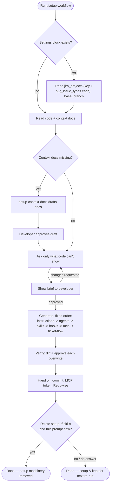
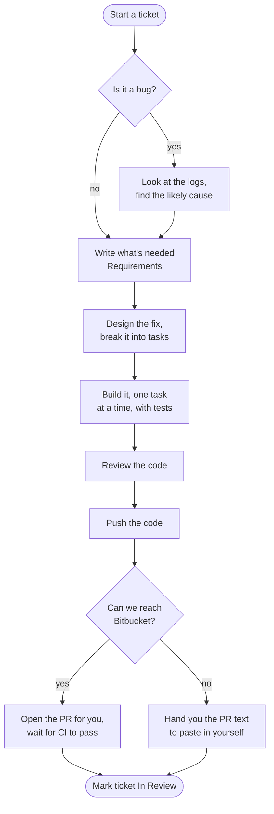
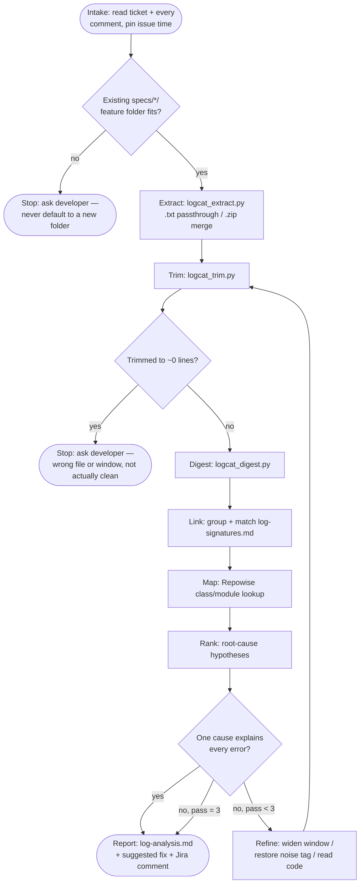

# Agentic AI-SDLC workflow — implementation reference

Design reference for the **generated** Agentic AI-SDLC workflow — what actually runs inside an app
repo once setup has produced it: the one-time setup wizard as experienced there, the daily ticket
pipeline, the log-analysis loop, the safety mechanisms wrapping all of it, and — in §11 — exactly
where every one of those files lives in that app repo. Each skill's own `SKILL.md` is the
authoritative source for its own behavior — this document is a synthesis for a single-page view,
not a replacement.

## 1. System map

| Place | Holds |
|---|---|
| **App repo** | Generated instructions, agents, skills, prompts, hooks, MCP config; the ticket specs |
| **Developer machine** | Filled-in `mcp.json` with a real Atlassian token; optional Repowise index |

`/setup-workflow`, run once inside the app repo, generates everything else listed below.

## 2. Setup phase (once per repo)



## 3. Daily ticket workflow (spec-driven development)

The shape of it, start to finish. The developer approves every step along the way — nothing moves
to the next box without an explicit yes — and a failed check always loops back to the box before
it, rather than skipping forward.



That `I` step is a real, current gap worth naming plainly: opening a PR and checking CI both need
Bitbucket access through the Atlassian Rovo MCP server, which depends on a scoped API token and an
admin turning on the Bitbucket tools — nothing this workflow controls. Without it, this workflow
never blocks on it; it just hands the developer the PR text to paste in by hand instead (see
`ticket-ship`'s own `SKILL.md`, "If the Bitbucket tools aren't available").

## 4. Log-analysis loop (bug tickets only)



Three scripts in this loop are plain Python, no AI, no network: `logcat_extract.py` normalizes the
raw attachment (a plain `.txt`/`.log` passes through unchanged; a `.zip` is extracted and, if it
holds more than one text log, merged in chronological order) into the single file `logcat_trim.py`
expects, and `logcat_digest.py` groups that trimmed log's warnings and errors by signature.

## 5. Agents

| Agent | Job | Tools | MCP | Hard scope rule |
|---|---|---|---|---|
| `log-analyser` | Root-causes a bug ticket's logs with a suggested fix | read, edit, search, runCommands (scripts only) | atlassian-rovo, repowise | Writes only `log-analysis.md`; runs only the three log scripts, in order |
| `ticket-analyst` | Writes `requirements.md` | read, edit, search | atlassian-rovo, figma, repowise | Writes only `requirements.md` |
| `architect` | Writes `design.md`, `tasks.md` | read, edit, search | repowise | Writes only those two files; no new architectural layer |
| `developer` | Implements `tasks.md` | read, edit, search, runCommands | repowise | One task at a time, in order, only via the named skill |
| `test-writer` | Tests each task | read, edit, search, runCommands | repowise | Edits only test files for the in-progress task |
| `code-reviewer` | Reviews diff vs. spec | read, search | repowise | Read-only; checks the specs-only rule on every diff |
| `security-reviewer` | Reviews sensitive-area diffs | read, search | repowise | Read-only; only runs when flagged by `code-reviewer` |

Tool lists are the *mechanical* half of scope enforcement (Copilot can strip `edit` outright); the
*written* half — "only these files," "only these commands" — lives in each agent's own blueprint.
`code-reviewer` is the backstop that actually checks the written half was followed.

## 6. Skills

| Layer | Skills |
|---|---|
| **Orchestration** | `ticket-start`, `ticket-ship` |
| **Implementation** | `new-feature`, `new-screen`, `new-ble-command`, `new-api-call`, `room-migration`, `write-tests` |

`new-ble-command` and `room-migration` are only generated when BLE or Room is actually detected in
the app repo; the rest are always generated.

## 7. Hooks

| Hook | Event | Denies / does |
|---|---|---|
| `format-kotlin` | `postToolUse` | Runs the formatter on an edited `.kt`/`.kts` file (never denies — event fires after the fact) |
| `block-force-push` | `preToolUse` | Denies a shell command containing `git push` + `--force`/`--force-with-lease`/`-f` |
| `protect-secrets` | `preToolUse` | Denies reads/edits/commands naming a `sensitive-paths.txt` entry; denies text containing a JWT or token-shaped string |
| `guard-context-docs` | `preToolUse` | Asks before `project-context.md`/`architecture.md` is touched; `ask` degrades to `deny` if the agent mode can't ask |

Protocol: each script reads one JSON object on stdin (`event`, `tool`, `paths`, `command`, `text`)
and writes one JSON decision (`allow` / `deny` / `ask`) to stdout. A non-zero exit or a 30-second
timeout both fall back — a crash denies the action, a timeout silently allows it (open item 4 in
§10).

## 8. MCP servers

| Server | Used for | Auth |
|---|---|---|
| Atlassian Rovo MCP | Jira, Confluence, Bitbucket Cloud | OAuth (Jira/Confluence); Basic auth API token (Bitbucket) |
| Figma MCP | Linked designs, read-only | Developer's Figma sign-in |
| Repowise | Code map, risk, dead-code (advisory only) | None — local, optional |

## 9. Safety & control principles

- **Developer approves every gate** — the setup brief, each spec file, every overwrite, and the
  commit/push/PR step all wait for an explicit yes.
- **Spec before code** — no feature branch exists until `tasks.md` is approved; `developer` can't
  start a task the spec doesn't list.
- **Context docs are read, not guessed** — drafted only when missing, cited line-by-line, never
  regenerated once written.
- **Redact before sharing** — raw logs stay in a git-ignored `.logs/` folder; everything else sees
  only trimmed/digested/redacted output.
- **Mechanical enforcement where possible, written rules elsewhere** — reviewers lose the `edit`
  tool outright; path-scoping ("specs only," "scripts only") is a written rule, checked by
  `code-reviewer`.
- **No secrets in the repo** — both MCP files ship with an empty token slot; `protect-secrets`
  blocks the paths that would leak one.

## 10. Known gaps / open risk items

Found by audit, not yet closed — listed here so they stay visible rather than living only in chat:

1. **Test/spec gaming under pressure** — nothing stops `test-writer` from weakening an assertion,
   or `architect`'s "plan changed" re-approval path from being used to dodge a hard bug rather than
   fix it.
2. **UI error/loading/empty states** — `new-screen` and `xml-ui.instructions.md` stop at wiring;
   nothing requires a screen to handle or test a failure/loading/empty state.
3. **No retry cap for `developer`/`test-writer`** — unlike `log-analyser`'s 3-pass cap, nothing
   says "stop and report" after N failed attempts at a task.
4. **Silent hook degradation** — a timed-out guard "falls back to normal permissions" with no
   requirement that the agent notice or disclose it.
5. **Multi-repo partial failure in `ticket-ship`** — no defined behavior if repo 2's push/PR fails
   after repo 1 succeeded, or if a Pipelines run actually fails rather than just being pending.
6. **"Resolved" is undefined** for review comments — unclear if a developer override counts.
7. **Ticket reclassified after `ticket-start` runs** — issue type is read once; a later
   feature→bug (or reverse) reclassification isn't re-checked.
8. **Technically-passing-but-wrong-approach implementations** — `code-reviewer` checks criteria are
   met, not that the approach matches `design.md`'s intent.
9. **Flaky test passes** — the gate is "passed locally, once"; no rule addresses intermittent tests.
10. **Branch/feature-folder collisions** — no rule for two tickets proposing the same slug.

## 11. Folder structure

Where every file lives in a generated app repo, and which of those paths are a real GitHub Copilot
standard versus a convention this workflow invented for itself.

### 11.1 App repo, after `/setup-workflow`'s first run

Assumes the full target stack (both BLE stacks, Room, AppSync all detected — see §11.1.1 for what's
conditional).

```
<app-repo>/
├── project-context.md                 drafted by setup-context-docs if missing; never regenerated
├── architecture.md                    same
├── workflow.prompt.md                 pre-existing — linked, never written by this workflow
├── docs/workflows/                    pre-existing — same
├── .gitignore                         .logs/ appended by setup-agents (file created if missing)
├── specs/
│   └── .templates/
│       ├── requirements-template.md
│       ├── design-template.md
│       └── tasks-template.md          scaffolds only — see §11.3 for the -template.md convention
├── .logs/                             created lazily, git-ignored — see §11.2
└── .github/
    ├── copilot-instructions.md        settings block + module map + key rules + links
    ├── instructions/                  8 files, conditional — see §11.1.1
    │   ├── kotlin.instructions.md
    │   ├── xml-ui.instructions.md
    │   ├── koin-di.instructions.md
    │   ├── ble-halo.instructions.md
    │   ├── ble-gdo.instructions.md
    │   ├── data-layer.instructions.md
    │   ├── testing.instructions.md
    │   └── gradle.instructions.md
    ├── agents/                        all 7 always generated
    │   ├── log-analyser.agent.md
    │   ├── ticket-analyst.agent.md
    │   ├── architect.agent.md
    │   ├── developer.agent.md
    │   ├── test-writer.agent.md
    │   ├── code-reviewer.agent.md
    │   └── security-reviewer.agent.md
    ├── log-analyser/
    │   ├── scripts/logcat_extract.py
    │   ├── scripts/logcat_trim.py
    │   ├── scripts/logcat_digest.py
    │   └── log-signatures.md
    ├── skills/
    │   ├── new-feature/SKILL.md
    │   ├── new-screen/SKILL.md
    │   ├── new-ble-command/SKILL.md   conditional — see §11.1.1
    │   ├── new-api-call/SKILL.md
    │   ├── room-migration/SKILL.md    conditional — see §11.1.1
    │   ├── write-tests/SKILL.md
    │   ├── ticket-start/SKILL.md
    │   ├── ticket-ship/SKILL.md
    │   └── setup-*/                   retained by default, deletable on request — see §11.1.2
    ├── prompts/
    │   ├── setup-workflow.prompt.md   kept by default, same as setup-*/ — the re-run entry point
    │   ├── log-analyser.prompt.md
    │   ├── new-feature.prompt.md
    │   ├── new-screen.prompt.md
    │   ├── new-ble-command.prompt.md
    │   ├── new-api-call.prompt.md
    │   ├── room-migration.prompt.md
    │   ├── write-tests.prompt.md
    │   ├── ticket-start.prompt.md
    │   └── ticket-ship.prompt.md
    ├── hooks/
    │   ├── guards.json
    │   ├── sensitive-paths.txt
    │   └── scripts/  (format-kotlin, block-force-push, protect-secrets, guard-context-docs — each .sh + .ps1)
    ├── mcp/jetbrains-mcp.example.json
    └── mcp.json
```

#### 11.1.1 Conditional pieces

Gated on what `setup-workflow`'s Read step actually detects — absent entirely for a repo that
doesn't match the signal, never generated as an empty placeholder:

| File(s) | Generated when |
|---|---|
| `ble-halo.instructions.md`, `ble-gdo.instructions.md`, `new-ble-command/` | that BLE stack is detected |
| `room-migration/` | Room (`@Database`) is detected |
| `koin-di.instructions.md` | Koin is detected |
| `xml-ui.instructions.md`, `new-screen/` | XML + View Binding is detected |

Everything else (`kotlin.instructions.md`, `testing.instructions.md`, `gradle.instructions.md`,
all 7 agents, `new-feature`, `write-tests`, `ticket-start`, `ticket-ship`) is always generated.

#### 11.1.2 `.github/skills/setup-*/` is retained by default, deletable on request

No `SKILL.md` deletes the `setup-*` skills automatically — but `setup-workflow`'s own step 7 (Hand
off) now asks, once, whether to delete them (and `.github/prompts/setup-workflow.prompt.md`) now
that generation is done, explaining the trade-off: the daily commands never read anything under
`setup-*/` again (they're independent copies elsewhere under `.github/`), but keeping it is what
makes `/setup-workflow` re-runnable later without first re-running the setup tool's own bootstrap
step. It deletes only on an explicit yes; absent one, everything is left in place.

### 11.2 Per-ticket runtime additions

Not present until a ticket is actually worked; one set per ticket, inside its feature folder.

```
specs/<feature>/<ticket-id>/
├── log-analysis.md      bug tickets only — written by log-analyser
├── requirements.md      written by ticket-analyst
├── design.md             written by architect
└── tasks.md              written by architect

.logs/<ticket-id>/
├── raw/                 as captured (.txt/.log, or a .zip) — protect-secrets hook blocks Copilot reads
│   └── extracted/        logcat_extract.py's output — same hook applies, still the full raw log
├── trimmed.log           redacted + windowed — what log-analyser actually reads
└── digest.md             error groups with counts and first/last times
```

### 11.3 Naming conventions: specification compliance

Every path under `.github/` conforms to a documented GitHub Copilot customization path, verified
against the [customization cheat sheet](https://docs.github.com/en/copilot/reference/customization-cheat-sheet).
Every path outside `.github/` — `specs/`, the `-template.md` suffix, the `generated-by` marker — is
a project-specific convention introduced by this workflow; GitHub Copilot has no knowledge of it and
assigns it no behavior.

| Path / suffix | Classification | Notes |
|---|---|---|
| `.github/copilot-instructions.md` | GitHub Copilot specification | Repository-wide instructions |
| `.github/instructions/*.instructions.md` | GitHub Copilot specification | Path-specific instructions; requires an `applyTo` front-matter field |
| `.github/prompts/*.prompt.md` | GitHub Copilot specification | Slash-command shortcuts |
| `.github/agents/*.md` | Location per specification; `.agent.md` suffix is a project convention | The specification requires only that the file reside in `.github/agents/`; the `.agent.md` suffix is applied by this workflow for readability and is not required by GitHub Copilot |
| `.github/skills/<name>/SKILL.md` | GitHub Copilot specification | Also valid under `.claude/skills/` or `.agents/skills/`; this workflow does not write to either location |
| `.github/hooks/*.json` | GitHub Copilot specification | This workflow consolidates all hooks into a single `guards.json`; the specification also permits multiple hook files |
| `~/.copilot/skills/` | GitHub Copilot specification (user scope) | A per-user, home-directory skill location; this workflow does not write to it |
| `specs/<feature>/<ticket-id>/` | Project-specific convention | Not a GitHub Copilot concept; the path is defined and honored by `ticket-analyst`, `architect`, and `log-analyser` |
| `specs/.templates/*-template.md` | Project-specific convention | The `-template` suffix excludes blueprint files from any glob that scans `specs/**/requirements.md` for live ticket specs, while the `.md` extension preserves Markdown rendering in editors and previews |
| `*-template.md` elsewhere (`copilot-instructions-template.md`, `project-context-template.md`, …) | Project-specific convention | Applied for the same reason, consistently, across every file this workflow generates |
| `generated-by: copilot-workflow` marker | Project-specific convention | Distinguishes files written by `setup-workflow` from developer-authored files on a re-run |
| `jira_projects` settings-block field (and its per-entry `key`/`bug_issue_types`) | Project-specific convention | Not a GitHub Copilot concept; part of this workflow's own re-run contract |

**Implication.** A path classified as GitHub Copilot specification is governed by GitHub's
published behavior and remains valid for as long as that specification does. A path classified as a
project-specific convention carries no external enforcement — it functions only because every
agent and skill that reads or writes it has been written to honor it consistently. Any change to
the `specs/` layout or the `-template.md` convention must therefore be mirrored across all of them.
